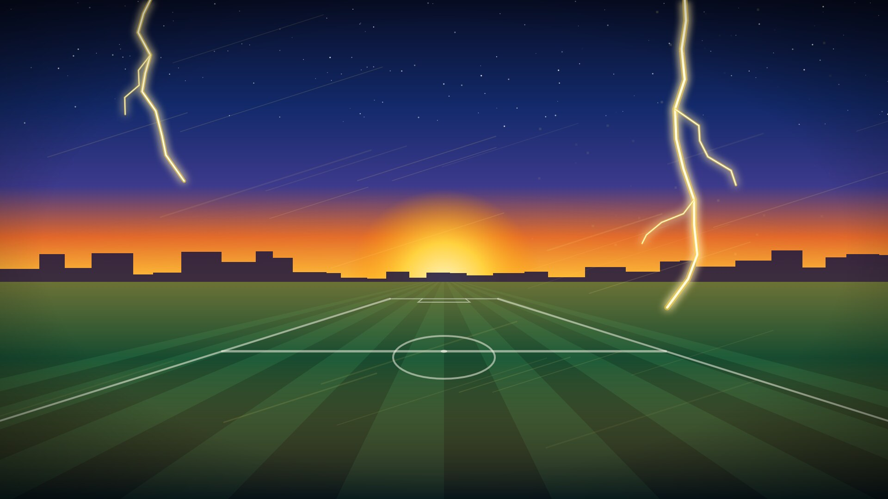

# ⚡ Inazuma Eleven — thème Discord

Thème Discord aux couleurs de Raimon : bleu nuit, jaune éclair et orange bandeau,
avec un fond de terrain de foot au coucher du soleil traversé par des éclairs.



Compatible **Vencord**, **Equicord** et **BetterDiscord**, ancienne et nouvelle interface de Discord.

## Installation

### Vencord / Equicord (recommandé)

1. Paramètres → **Themes** → onglet **Online Themes**
2. Colle ce lien, puis active-le :

```
https://cdn.jsdelivr.net/gh/XxWirexX/inazuma-discord-theme@main/inazuma.theme.css
```

Le thème se met à jour tout seul à chaque push (jsDelivr peut garder l'ancienne version en cache jusqu'à 12 h).

### BetterDiscord

Télécharge [`inazuma.theme.css`](inazuma.theme.css) et mets-le dans le dossier des thèmes
(Paramètres → Thèmes → *Ouvrir le dossier des thèmes*).

### QuickCSS (sans installer de thème)

```css
@import url("https://cdn.jsdelivr.net/gh/XxWirexX/inazuma-discord-theme@main/inazuma.theme.css");
```

## Personnaliser

Ajoute ces lignes dans ton QuickCSS (ou modifie le bloc `:root` en haut du fichier) :

```css
:root {
  --inazuma-bg: url("https://ton-image.jpg");  /* ton propre fond d'écran */
  --inazuma-dim: 0.35;    /* assombrissement du fond, 0 → 1 */
  --inazuma-panel: 0.62;  /* opacité des panneaux, plus bas = plus de fond visible */
  --inazuma-blur: 6px;    /* flou derrière les panneaux, 0px si ton PC rame */
}
```

Les couleurs (`--inazuma-yellow`, `--inazuma-orange`, `--inazuma-blue`…) sont au format `R, G, B`.

## Fond d'écran

`assets/background.svg` est la source (généré, original), `assets/background.jpg` le rendu 1920×1080 utilisé par le thème.

---

Thème fan non officiel, sans lien avec Level-5. Inazuma Eleven est une marque de Level-5 Inc.

> Le repo vient du modèle « programme VPS » : le `docker-compose.yml` et le workflow de déploiement
> sont toujours là et lancent le conteneur de démo à chaque push. Ils ne servent pas au thème.
